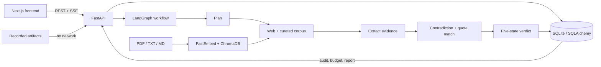

# VeriAgent

VeriAgent is a production-shaped claim-investigation demo that returns a five-state verdict,
source-linked evidence, and an inspectable audit trail.

## Demo

The repository includes three pre-seeded replay claims that work without model or search API
credentials. A 60–90 second product recording is still pending; when recorded, place it at
`docs/assets/veriagent-demo.gif` and replace this paragraph with the image.

This is a portfolio project, not a hosted fact-checking service. Its scope is to demonstrate the
engineering of a bounded, observable agent workflow: typed state, evidence provenance, live
progress, resource controls, deterministic replay, evaluation hooks, and deployment-shaped
configuration. It does not claim production uptime or independently measured fact-checking
accuracy.

## Problem

Most answer systems optimize for a plausible response. A fact-verification workflow needs a
different set of controls: source retrieval, preserved evidence, counter-evidence searches,
quote verification, calibrated verdicts, resource limits, and a record of how the result was
produced.

VeriAgent treats verification as a bounded research process rather than a single model prompt.

## How it works

1. The planner splits a submitted statement into testable subclaims and search questions.
2. The researcher retrieves, deduplicates, and ranks candidate sources.
3. The extractor records quotations and links them to stored source snapshots.
4. The contradiction stage searches for exceptions and conflicting evidence.
5. The verifier checks quote matches and identifies unsupported conclusions.
6. The reporter issues one of five verdicts with limitations and citations.
7. Audit events and budget usage are persisted and streamed to the frontend.



## What makes it different

1. **Five verdicts.** Results can be `SUPPORTED`, `REFUTED`, `MIXED`, `CONDITIONAL`, or
   `INSUFFICIENT`; the system is not restricted to true/false output.
2. **Snapshot-matched quotations.** Evidence quotes must match stored source text before they can
   support a conclusion. This verifies textual presence, not source truthfulness.
3. **Counter-evidence search.** Contradictions and boundary conditions are investigated as a
   separate workflow stage.
4. **Source independence controls.** Duplicate URLs and repeated publications are reduced before
   synthesis.
5. **Hard budgets.** Tokens, searches, fetches, loops, and wall time have server-enforced caps.
6. **Inspectable execution.** Ordered audit events and live budget usage are available through
   REST and Server-Sent Events.
7. **Offline replay.** Completed runs and seeded demonstrations can be reproduced without network
   or model calls.

Together, these are the project's demonstrated capabilities. General fact-checking accuracy,
production availability, and resistance to every form of source manipulation remain outside the
evidence currently available in this repository.

## Tech stack

| Area | Technology |
|---|---|
| API | Python 3.11, FastAPI, Pydantic v2 |
| Workflow | LangGraph |
| Models | LiteLLM; Gemini 3.6 Flash for routine stages and Gemini 3.8 Flash for synthesis |
| Retrieval | DDGS metasearch, Wikipedia, OpenAlex, optional Tavily |
| Curated RAG | FastEmbed, ChromaDB, pypdf |
| Persistence | SQLAlchemy, SQLite by default |
| Frontend | Next.js App Router, React, TypeScript, Tailwind CSS |
| Streaming | Server-Sent Events |
| Testing | pytest, FastAPI TestClient, FakeLLM |
| Deployment | Docker, Docker Compose, Render Blueprint, Vercel |

## Quick start

### Docker Compose

Requirements: Docker Desktop with Compose v2 and Python 3.11+ for the smoke test.

```powershell
Copy-Item .env.example .env
docker compose up --build --detach
python scripts/smoke_test.py http://localhost:8000
```

Open `http://localhost:3000`. The three sample claims use pre-seeded offline replays and do not
require provider keys.

```powershell
docker compose logs --follow backend
docker compose down
```

### Run from source

Backend:

```powershell
Copy-Item .env.example .env
Set-Location backend
python -m venv .venv
.\.venv\Scripts\Activate.ps1
python -m pip install -e ".[dev]"
uvicorn veriagent.main:app --reload --host 0.0.0.0 --port 8000
```

Frontend, in a second terminal:

```powershell
Set-Location frontend
npm ci
$env:NEXT_PUBLIC_API_URL="http://localhost:8000"
npm run dev
```

Run checks from the repository root:

```powershell
make lint
make test
make eval
```

On Windows, the MinGW executable may be named `mingw32-make`; it accepts the same targets.

Upload a curated document and run a corpus ablation evaluation:

```powershell
curl.exe -X POST http://localhost:8000/api/corpus -F "file=@.\corpus\evidence.pdf" -F "title=Reviewed evidence"
Set-Location backend
.\.venv\Scripts\python.exe -m eval.run_eval --mode record --compare-corpus
```

Replay-mode corpus comparisons use separately recorded artifacts under
`backend/eval/dataset/replays/with-corpus/` and `without-corpus/`.

See [DEPLOYMENT.md](DEPLOYMENT.md) for Render and Vercel instructions and the complete environment
variable list.

## Evaluation results

The current regression gate is a deterministic smoke test, not a research benchmark. It contains
one implementation-authored EV claim and has not received independent label review. These numbers
prove that the replay and metric pipeline are stable; they do not estimate general accuracy.

| Metric | Result | Dataset/version |
|---|---:|---|
| Retrieval precision | `1.000` | `smoke-v1`, n=1 |
| Citation validity | `1.000` | `smoke-v1`, n=1 |
| Classification accuracy | `1.000` | `smoke-v1`, n=1 |
| Unsupported-claim rate | `0.000` | `smoke-v1`, n=1 |
| Exact human-verdict agreement | `1.000` | `smoke-v1`, n=1 |
| Adjacent human-verdict agreement | `0.000` | `smoke-v1`, n=1 |
| Curated-corpus ablation | `Not available` | paired replay artifacts not yet recorded |

Evaluation reports are written to `backend/eval/reports/` as JSON and Markdown. The confusion
matrix and per-claim results are included in each report. See
[`docs/eval-report.md`](docs/eval-report.md) for construction, review status, and interpretation.

## Limitations and honest caveats

- Retrieval coverage depends on public search endpoints, source availability, and page parsing.
- PDF ingestion extracts embedded text but does not perform OCR on scanned pages.
- The local Chroma index is single-node storage and must fit the deployment's memory and disk
  limits.
- A verified quote proves that text appears in a stored snapshot; it does not prove that the
  source is correct or that the quote entails the claim.
- Model-generated decomposition, evidence classification, and synthesis can still be wrong.
- Source ranking uses heuristics and cannot fully measure expertise, independence, or conflicts
  of interest.
- The current rate limiter is in memory and is not shared across multiple API instances.
- SQLite is suitable for local use and a stateless demo, but not for durable multi-instance
  production deployment.
- Free hosting can introduce cold starts, ephemeral storage, and external API limits.
- Free model quotas are suitable for reviewer traffic and demonstrations, not sustained public
  usage. The replay path is the reliable showcase path when providers are unavailable.
- The seeded demo reports are fixed examples, not fresh investigations.
- Live claims require a configured LLM provider. Without one, non-demo runs terminate at the
  planner; the three seeded replay claims still work.
- The checked-in evaluation set has one claim and no independent reviewer. Its perfect scores
  must not be presented as evidence of broad accuracy.
- A with/without-corpus result is not published because the paired replay artifacts have not been
  recorded. Copying the same replay into both groups would not be a valid ablation.
- The public API has no user accounts or authorization layer. Do not store sensitive claims.

VeriAgent is a research tool, not a substitute for professional medical, legal, financial, or
safety advice.

## Roadmap

- Expand the reviewed evaluation dataset across domains and verdict classes.
- Add durable PostgreSQL persistence and database migrations.
- Add authentication, per-user quotas, and distributed rate limiting.
- Improve domain provenance, publication-family detection, and source independence scoring.
- Add stronger entailment checks alongside deterministic quote matching.
- Support resumable runs and queued workers for longer investigations.
- Add export formats and shareable, versioned reports.
- Add deployment monitoring, structured traces, and cost reporting.
